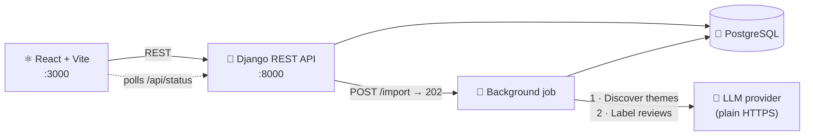

<div align="center">

# 🍽️ Zesto Review Insights

### Turn hundreds of app reviews into one clear answer: *what should we fix first?*


[Features](#-features) · [Quick Start](#-quick-start) · [Architecture](#-architecture) · [API](#-api) · [Evaluation](#-how-well-it-works)

</div>

---

## 💡 What is it?

Zesto Review Insights shows a product manager **what customers talk about** in app reviews, **how they feel** about each topic, and **the exact reviews behind every number**. No hand-made categories: the themes are discovered from the data by an LLM.

> **Built for Priya, the PM.** Her decision: *which customer problem do we fix first, and did the last fix work?*

## ✨ Features

| | Feature | What it gives you |
|---|---|---|
| 🧭 | **Auto-discovered themes** | 5–12 themes with sub-themes, found from the reviews. Nothing hard-coded. |
| 😊 | **Per-topic sentiment** | One (theme, sub-theme, sentiment) per topic a review mentions. |
| 📊 | **Dashboard** | Counts, share of reviews and a negative/positive bar. Sort by *most mentioned* or *most complaints*. |
| 🔎 | **Evidence on click** | Open any theme or sub-theme to read the actual reviews, filtered by sentiment. |
| 🎛️ | **Filters** | City, platform, month and rating. |
| 📈 | **What changed** | Month-over-month complaint share per theme, with sparklines and *getting worse* / *improving* call-outs. |
| 💬 | **Ask** | Plain-English questions. The LLM builds the query, the **database does the counting**. Unanswerable questions get an honest "can't answer". |
| 🔑 | **Works without a key** | App starts and imports anyway. Add a key later and analysis resumes by itself. |

> 📈 **Why "What changed" uses shares, not counts:** review volume changes every month, so raw counts would mislead. The share of complaints answers "what got worse since last time?"

## 🚀 Quick Start

**Requirements:** Docker + Docker Compose

```bash
# 1. add ONE LLM key
cp .env.example .env

# 2. start everything
docker compose up --build
```

| Service | URL |
|---|---|
| 🖥️ UI | http://localhost:3000 |
| ⚙️ API health | http://localhost:8000/api/health |

Then click **Choose CSV file** in the UI, or import from the terminal:

```bash
curl -F file=@data/reviews.csv localhost:8000/api/import
```

🧪 **Run the tests**

```bash
docker compose exec backend python manage.py test
```

<details>
<summary><b>🔧 Configuration: LLM providers</b></summary>

<br>

Set **one** key in `.env`. The first key found picks the provider, or force one with `LLM_PROVIDER`.

| Variable | Provider | Default model |
|---|---|---|
| `OPENAI_API_KEY` | OpenAI | `gpt-4o-mini` |
| `ANTHROPIC_API_KEY` | Anthropic | `claude-haiku-4-5` |
| `GEMINI_API_KEY` | Google Gemini | `gemini-2.5-flash` |
| `GROQ_API_KEY` | Groq | `llama-3.3-70b-versatile` |
| `OPENROUTER_API_KEY` | OpenRouter | `openai/gpt-4o-mini` |

Each provider has its own model variable (`OPENAI_MODEL`, `GEMINI_MODEL`, …). `LLM_MODEL` overrides all of them. Ports: `API_PORT` (8000) and `WEB_PORT` (3000).

</details>

<details>
<summary><b>📄 Input format</b></summary>

<br>

```
review_id,date,city,platform,rating,review_text
```

See `data/reviews.csv` for 300 sample reviews.

</details>

## 🏗️ Architecture



### How the analysis works

Labelling hundreds of reviews takes about a minute, so `POST /api/import` returns `202` immediately and the work runs in a background thread. Progress is saved in `AnalysisJob`, and the UI polls `/api/status`.

1. 🔍 **Discover**: the LLM reads the reviews and proposes themes with sub-themes.
2. 🏷️ **Label**: batches of 20 reviews, 4 in parallel. The LLM may add a new theme if nothing fits (shown as a **new topic** badge).

**Built to be robust**
- Theme names are matched loosely (case, typos).
- Reviews with no letters (`.`, `👍`) become `NONE` without an LLM call.
- Skipped reviews are retried, then retried in smaller batches. Anything still missing is exported as `NONE` and counted in the UI.
- Saved progress makes the job **resumable** after a server restart.

### Data model

| Model | Purpose |
|---|---|
| `Review` | Raw CSV row |
| `Theme` / `SubTheme` | Topics found from the data |
| `ReviewLabel` | review + theme + sub-theme + sentiment (unique per review+theme = one export row) |
| `AnalysisJob` | Status, progress, error |

## 🔌 API

| Endpoint | Purpose |
|---|---|
| `GET /api/health` | `200` when the DB is ready |
| `POST /api/import` | CSV upload (`file`), starts analysis, returns `202` |
| `GET /api/export/labels.csv` | `202` while running · `503` if no key / failed · then `200` with the CSV |
| `GET /api/status` | LLM config + job progress |
| `POST /api/analysis/run` | Re-run; `{"reset": true}` rebuilds themes from scratch |
| `GET /api/themes` · `/api/reviews` · `/api/trends` · `/api/filters` | Dashboard data; all accept `city`, `platform`, `month`, `rating` |
| `POST /api/ask` | Question → answer + evidence review ids |

<details>
<summary><b>📁 Project structure</b></summary>

<br>

```
.
├── backend/
│   ├── config/            Django settings, urls, wsgi
│   └── reviews/
│       ├── llm.py         standard-library LLM client (5 providers)
│       ├── labelling.py   theme discovery + batch labelling
│       ├── pipeline.py    background job, progress, resume
│       ├── importer.py    CSV import
│       ├── queries.py     themes / trends / filters
│       ├── ask.py         question → structured query → answer
│       ├── models.py · views.py · urls.py
│       └── tests/
├── frontend/src/          App.jsx, api.js, components/
├── data/
│   ├── reviews.csv        sample reviews
│   └── labels.csv         reference labels for scoring
├── check_labels.py        scores your export against the reference
└── docker-compose.yml     db + backend + frontend
```

</details>

## 🎯 How well it works

```bash
curl -s localhost:8000/api/export/labels.csv > my_labels.csv
python3 check_labels.py my_labels.csv
```

The script maps each of your themes to the reference theme with the most shared reviews, then reports **theme precision / recall / F1** and **sentiment accuracy**.

**Model used:** `TODO`

```
TODO: paste the output here
```

**Two cases it gets wrong**
1. TODO (review id, what we said vs. the reference label, why)
2. TODO

## 🤖 AI tools

TODO: list each tool and what you used it for.

## 🎨 Design decisions

- 📦 **No new packages**: the LLM is called over plain HTTPS with Python's standard library.
- 🧮 **The database counts, the LLM only translates**: so answers can't be hallucinated numbers.
- ✂️ **Left out on purpose**: login/users, manual label editing, multiple datasets, charts that don't help the decision.

## 🗺️ Next steps

- [ ] Merge near-duplicate new themes with a consolidation pass; let the PM rename or merge themes in the UI
- [ ] Move background work to a task queue (Celery/RQ) for many users and large files
- [ ] Measure accuracy per theme, tune prompts on failure cases, cache LLM answers
- [ ] Alert when a theme's complaint share jumps week over week

---

<div align="center">

Built by [Raushan Raj](https://github.com/Raushan23raj) · ⭐ Star the repo if you found it useful

</div>
